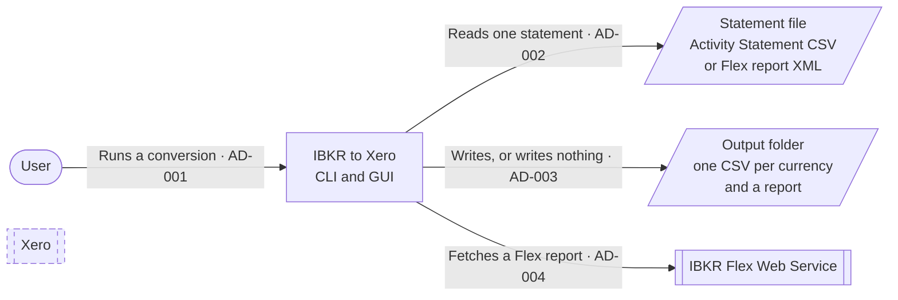
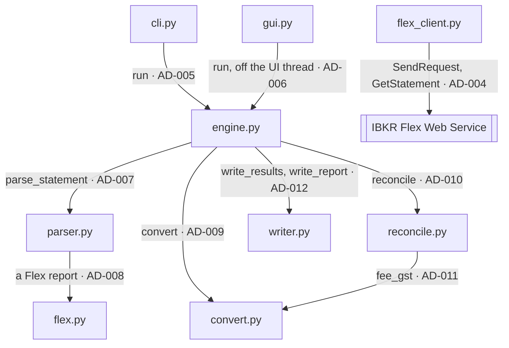

# IBKR to Xero — Architecture

| | |
|---|---|
| **Document** | How the converter is built: its modules, the data between them, the rules they enforce, and how it ships |
| **Status** | Current design, maintained with the code: a change to either changes the other in the same commit |
| **Items** | [AD-001](#ad-001) to [AD-077](#ad-077). The next takes **AD-078** |

## Contents

- [Conventions](#conventions)
- [1. Context](#1-context)
- [2. Modules](#2-modules)
- [3. The model](#3-the-model)
- [4. Reading an Activity Statement](#4-reading-an-activity-statement)
- [5. Reading a Flex report](#5-reading-a-flex-report)
- [6. Conversion](#6-conversion)
- [7. Reconciliation](#7-reconciliation)
- [8. Output](#8-output)
- [9. Front ends](#9-front-ends)
- [10. The Flex Web Service client](#10-the-flex-web-service-client)
- [11. Distribution](#11-distribution)

## Conventions

- **Items** are `AD-nnn`, each anchored where it is defined. An item is one element of the
  design that code or configuration realises: a module, an interface, a data structure or
  format, a rule, a setting. It states the design in the present tense, and what it states is
  binding on the code.
- **Decisions.** An item that carries out a decision of a plan in `planning/` names it in its
  Decisions column, and every mention of a decision is a link to its anchor in the plan
  (`[D16](planning/2026-11-11-flex-store-plan.md#d16)`). The plan holds why; this document
  holds what is built.
- **Diagrams** are Mermaid. Every arrow is an item, labelled "text · AD-nnn" on the arrow and
  listed in the table beneath the diagram. An arrow drawn in more than one diagram is one item,
  defined under the first. A dashed node belongs to a later stage: it shows where that stage
  plugs in, and has no arrows or items until then. Every row of a table with an Item column is
  an item.
- **Traceability.** Code, scripts and configuration cite the items they realise in an
  `Implements:` comment — `# Implements: AD-012, AD-031` — at the module, function or setting
  that realises them; they cite a plan's `Dnn` as well where the reason matters to whoever
  edits that code. `tests/test_architecture.py` checks it with the rest of the suite: an
  undefined, duplicated or unlabelled identifier fails the run; an item nothing cites yet is
  reported as a warning, so the design can run ahead of the code.

## 1. Context

| Item | From | To | What crosses | Decisions |
|---|---|---|---|---|
| **AD-001** | The user | The app | One conversion of one statement, started from the command line ([AD-060](#ad-060)) or the desktop window ([AD-061](#ad-061)), with the options of [AD-059](#ad-059) | [D39](planning/2026-11-14-earlier-decisions.md#d39) |
| **AD-002** | The app | A statement file | The file the user names or drops: an Activity Statement CSV exported from Client Portal, or an Activity Flex Query report in XML; read, never modified | [D27](planning/2026-11-14-earlier-decisions.md#d27) |
| **AD-003** | The app | The output folder | Per currency with cash activity, a Xero bank-statement CSV ([AD-053](#ad-053)), and the run report ([AD-056](#ad-056)) — all of it, or nothing at all ([AD-052](#ad-052), [AD-054](#ad-054)) | [D23](planning/2026-11-14-earlier-decisions.md#d23), [D25](planning/2026-11-14-earlier-decisions.md#d25), [D40](planning/2026-11-14-earlier-decisions.md#d40), [D41](planning/2026-11-14-earlier-decisions.md#d41) |
| **AD-004** | The app | IBKR's Flex Web Service | HTTPS requests carrying the user's Flex token and query ID, and the Flex report returned ([AD-063](#ad-063)) | [D11](planning/2026-11-11-flex-store-plan.md#d11) |

Xero is drawn dashed: the CSVs are imported into Xero by the user, one per currency's bank
account; pushing to Xero directly is a later stage (`TODO.md` M5, [D4](planning/2026-11-11-flex-store-plan.md#d4)).

## 2. Modules

Every module imports `model.py` ([AD-013](#ad-013)); those imports are not drawn.

| Item | From | To | What crosses | Decisions |
|---|---|---|---|---|
| **AD-005** | `cli.py` | `engine.py` | `run(statement_path, RunOptions)` → `RunResult`, or a typed error ([AD-059](#ad-059)) | [D42](planning/2026-11-14-earlier-decisions.md#d42) |
| **AD-006** | `gui.py` | `engine.py` | The same call, made on a worker thread so the window stays responsive ([AD-061](#ad-061)) | [D42](planning/2026-11-14-earlier-decisions.md#d42), [D43](planning/2026-11-14-earlier-decisions.md#d43) |
| **AD-007** | `engine.py` | `parser.py` | `parse_statement(path)` → `Statement` ([AD-021](#ad-021)) | [D18](planning/2026-11-11-flex-store-plan.md#d18) |
| **AD-008** | `parser.py` | `flex.py` | `is_flex_report(path)` ([AD-028](#ad-028)), then `parse_flex(path)` → `Statement` for a Flex report | [D18](planning/2026-11-11-flex-store-plan.md#d18) |
| **AD-009** | `engine.py` | `convert.py` | `convert(Statement)` → currency → `OutputRow`s, unrounded ([section 6](#6-conversion)) | [D42](planning/2026-11-14-earlier-decisions.md#d42) |
| **AD-010** | `engine.py` | `reconcile.py` | `reconcile(Statement, rows, accept_unattributed_gst=)` → `CurrencyResult`s, or `ReconciliationError` ([AD-052](#ad-052)) | [D23](planning/2026-11-14-earlier-decisions.md#d23), [D42](planning/2026-11-14-earlier-decisions.md#d42) |
| **AD-011** | `reconcile.py` | `convert.py` | `fee_gst(Statement)` → fee ID → GST folded into it, so reconciliation checks that GST with the fees ([AD-051](#ad-051)) | [D19](planning/2026-11-11-flex-store-plan.md#d19) |
| **AD-012** | `engine.py` | `writer.py` | `write_results(results, folder, overwrite=, report_name=)` and `write_report(folder, name, text)` | [D41](planning/2026-11-14-earlier-decisions.md#d41), [D42](planning/2026-11-14-earlier-decisions.md#d42) |

| Item | Module | Its job | Decisions |
|---|---|---|---|
| **AD-013** | `model.py` | The typed model every other module shares ([section 3](#3-the-model)); no I/O | [D18](planning/2026-11-11-flex-store-plan.md#d18) |
| **AD-014** | `parser.py` | The Activity Statement front end ([section 4](#4-reading-an-activity-statement)), and `parse_statement`, which picks the front end by the file's content ([AD-028](#ad-028)) | [D18](planning/2026-11-11-flex-store-plan.md#d18) |
| **AD-015** | `flex.py` | The Flex report front end ([section 5](#5-reading-a-flex-report)); never imports `parser.py` | [D16](planning/2026-11-11-flex-store-plan.md#d16), [D18](planning/2026-11-11-flex-store-plan.md#d18) |
| **AD-016** | `convert.py` | Records to per-currency output rows ([section 6](#6-conversion)); unrounded amounts, no synthetic rows | [D28](planning/2026-11-14-earlier-decisions.md#d28), [D38](planning/2026-11-14-earlier-decisions.md#d38) |
| **AD-017** | `reconcile.py` | The Cash Report checks, synthetic rows and rounding ([section 7](#7-reconciliation)) | [D23](planning/2026-11-14-earlier-decisions.md#d23) |
| **AD-018** | `writer.py` | The CSV files and the report file ([section 8](#8-output)); the only module besides the front ends that writes files | [D25](planning/2026-11-14-earlier-decisions.md#d25), [D41](planning/2026-11-14-earlier-decisions.md#d41) |
| **AD-019** | `engine.py` | The one entry point every front end drives ([AD-059](#ad-059)); never prints | [D42](planning/2026-11-14-earlier-decisions.md#d42) |
| **AD-020** | `flex_client.py` | Runs a Flex query over HTTPS ([section 10](#10-the-flex-web-service-client)); no other I/O | [D11](planning/2026-11-11-flex-store-plan.md#d11), [D15](planning/2026-11-11-flex-store-plan.md#d15) |

## 3. The model

| Item | Element | Design | Decisions |
|---|---|---|---|
| **AD-021** | `Statement` | One statement period as every front end delivers it: `period_start`, `period_end`, `account`, `base_currency`; the records in four lists, each in source order — `trades`, `corporate_actions`, `cash_txns`, `tax_items`; and `cash_report`, currency → component → amount, components named as in the Activity Statement ("Starting Cash", "Trades (Sales)", …), the base-currency summary left out | [D18](planning/2026-11-11-flex-store-plan.md#d18) |
| **AD-022** | Records | `Trade`, `CorporateAction`, `CashTxn` and `TaxItem` share `id` (IBKR's transaction ID where the source has one, else the line number), `where` (how an error points at it: "line 57", "Flex CashTransaction 123") and `report_date` (where the source gives one). A trade's `commission` is the whole charge, taxes on it included; `proceeds` is `None` for futures | [D5](planning/2026-11-11-flex-store-plan.md#d5), [D18](planning/2026-11-11-flex-store-plan.md#d18) |
| **AD-023** | `CashKind` | The buckets cash transactions are checked in, in output order: Fees, Deposits & Withdrawals, Dividends, Withholding Tax, Interest, Commission Adjustments; each value is the bucket's name in notes and errors | [D28](planning/2026-11-14-earlier-decisions.md#d28) |
| **AD-024** | `AssetClass` | Stocks, options, futures, bonds and forex; the value is the output's Reference tag — `STOCK`, `OPTION`, `FUTURE`, `BOND`, `FX` | [D38](planning/2026-11-14-earlier-decisions.md#d38) |
| **AD-025** | `TaxKind` | Stamp duty — inside its trade's commission, for display and checks only — and GST, cash of its own, on the item its `taxed_id` names | [D19](planning/2026-11-11-flex-store-plan.md#d19) |
| **AD-026** | `OutputRow`, `CurrencyResult` | A row is a date, an amount (unrounded until [AD-048](#ad-048)), a description, the payee "Interactive Brokers", a Reference tag, and the section it came from (not written). A result is one currency's rows, its Starting and Ending Cash, and notes on what was verified or synthesised | [D25](planning/2026-11-14-earlier-decisions.md#d25), [D29](planning/2026-11-14-earlier-decisions.md#d29), [D30](planning/2026-11-14-earlier-decisions.md#d30) |
| **AD-027** | Money and errors | Every amount is a `Decimal`, parsed from the source's text, never a float; written plain, without trailing zeros. `StatementError`: the input is malformed or unsupported. `ReconciliationError`: the cash does not add up; its text is a report of every problem | [D23](planning/2026-11-14-earlier-decisions.md#d23), [D24](planning/2026-11-14-earlier-decisions.md#d24) |

## 4. Reading an Activity Statement

| Item | Element | Design | Decisions |
|---|---|---|---|
| **AD-028** | Picking the front end | A file whose first byte past a byte-order mark and whitespace is `<` is a Flex report ([section 5](#5-reading-a-flex-report)); anything else is read as an Activity Statement | [D18](planning/2026-11-11-flex-store-plan.md#d18) |
| **AD-029** | Sections | Every row is `Section,Kind,cells…`. A `Header` row names the columns of the `Data` rows after it, per section, and may be re-emitted (Trades does so per asset category). Rows of kind `Total`, `SubTotal`, `Total in USD`, `Notes` or empty are skipped; any other kind rejects. Trailing empty cells are tolerated, extra filled cells reject. The first cell carries a UTF-8 byte-order mark | [D27](planning/2026-11-14-earlier-decisions.md#d27) |
| **AD-030** | Period and account | The Statement section's Period field — "June 1, 2026 - June 30, 2026", or one date — gives the period; Account Information gives the account and base currency. No Period rejects | [D27](planning/2026-11-14-earlier-decisions.md#d27) |
| **AD-031** | Trades | `DataDiscriminator` `Order` rows are transactions; `ClosedLot`, `SubTotal` and `Total` are not; execution-level `Trade` rows reject, asking for order-level detail; any other rejects. Asset categories Stocks, Bonds, Equity and Index Options, Futures and Forex map to [AD-024](#ad-024); any other rejects. Futures need no Proceeds. A forex row's commission is in the one `Comm in XXX` column, which names its currency | [D27](planning/2026-11-14-earlier-decisions.md#d27), [D31](planning/2026-11-14-earlier-decisions.md#d31), [D32](planning/2026-11-14-earlier-decisions.md#d32), [D33](planning/2026-11-14-earlier-decisions.md#d33), [D58](planning/2026-11-14-earlier-decisions.md#d58) |
| **AD-032** | Cash sections | Fees, Deposits & Withdrawals (dated by Settle Date), Dividends, Withholding Tax, Interest and Commission Adjustments share Currency, Date, Description and Amount; Corporate Actions adds Proceeds; the Transaction Fees section becomes stamp-duty tax items. Rows whose Currency is not a three-letter code are aggregates and skipped. A record's ID is its line number, and it has no report date | [D27](planning/2026-11-14-earlier-decisions.md#d27), [D35](planning/2026-11-14-earlier-decisions.md#d35) |
| **AD-033** | Cash Report | Read in blocks, each opened by a `Starting Cash` row: rows belong to their block's currency, not their own Currency cell. The first, base-currency block is skipped. A duplicate block or component, or a row before any block, rejects; so does a statement without a Cash Report | [D23](planning/2026-11-14-earlier-decisions.md#d23), [D26](planning/2026-11-14-earlier-decisions.md#d26) |

## 5. Reading a Flex report

| Item | Element | Design | Decisions |
|---|---|---|---|
| **AD-034** | The section table | `SECTIONS` is the one table of what is read: each section's element, its name in Client Portal's query editor, the rows read and the level of detail they must have, and the attributes every such row must carry. It drives both the validation and the mapping. A missing section, level or field rejects, naming what to tick in the query | [D16](planning/2026-11-11-flex-store-plan.md#d16) |
| **AD-035** | The statement | The root is `FlexQueryResponse` with exactly one `FlexStatement`, which carries `accountId`, `fromDate` and `toDate` — more than one rejects, until multi-account reports are supported. Dates are `yyyyMMdd`, times `HHmmss`, joined by `;`; anything else rejects with the settings to choose. Rows carry `reportDate`, kept in the record | [D5](planning/2026-11-11-flex-store-plan.md#d5), [D16](planning/2026-11-11-flex-store-plan.md#d16), [D20](planning/2026-11-11-flex-store-plan.md#d20) |
| **AD-036** | Cash Report | One `CashReportCurrency` row per currency, at the currency level of detail; its attributes map to the model's component names. Identification attributes, the deposits-plus-withdrawals sum and the per-segment and running-total splits (`…Com`, `…Sec`, `…MTD`, `…YTD`) are not components; an unknown attribute passes through under its Flex name. Zero components are left out, except Starting and Ending Cash | [D16](planning/2026-11-11-flex-store-plan.md#d16) |
| **AD-037** | Trades | `Order` rows. Categories `STK`, `OPT`, `FUT`, `BOND` and `CASH` map to [AD-024](#ad-024); any other rejects. An option's symbol is its `description`, the readable contract. The commission is `ibCommission` plus `taxes`; only a forex trade's commission may be in another currency than the trade. The record ID is `ibOrderID` | [D16](planning/2026-11-11-flex-store-plan.md#d16), [D17](planning/2026-11-11-flex-store-plan.md#d17) |
| **AD-038** | Cash transactions and transfers | `CashTransaction` rows map by `type` to [AD-023](#ad-023); any other type rejects; deposits and withdrawals are dated by `settleDate`. Cash `Transfer` rows join the deposits and withdrawals, their description rebuilt in the Activity Statement's wording ("Internal Transfer In From Account …"); a position transfer moving cash rejects. Descriptions are otherwise Flex's own wording | [D16](planning/2026-11-11-flex-store-plan.md#d16), [D17](planning/2026-11-11-flex-store-plan.md#d17) |
| **AD-039** | Tax items | `TransactionTax` summary rows become stamp duty; `SalesTax` rows become GST naming the taxed item by `taxableTransactionID`; a tax type other than GST rejects | [D19](planning/2026-11-11-flex-store-plan.md#d19) |

## 6. Conversion

| Item | Element | Design | Decisions |
|---|---|---|---|
| **AD-040** | Output order | Per currency: trades, corporate actions, then cash transactions by [AD-023](#ad-023)'s order, each in source order | [D28](planning/2026-11-14-earlier-decisions.md#d28) |
| **AD-041** | Trade descriptions | One grammar: `{+\|-}{qty} {symbol} [({event})] price: {price} comm: {comm} [({qualifiers})]`. Zero price or commission is left out. Codes `A` and `Ep` add the events "assigned" and "expired"; other codes stay silent. The commission shows to the cent | [D38](planning/2026-11-14-earlier-decisions.md#d38) |
| **AD-042** | Cash trades | Stocks, options and bonds: one row in the trade's currency, proceeds plus commission | [D38](planning/2026-11-14-earlier-decisions.md#d38) |
| **AD-043** | Futures | One row of the commission alone, worded "… commission: {amt}": the notional never moves cash, and the P/L arrives as [AD-047](#ad-047) | [D31](planning/2026-11-14-earlier-decisions.md#d31) |
| **AD-044** | Forex | A trade on `BASE.QUOTE` is a transfer between two currency accounts: the base currency moves by the quantity, the quote currency — the trade's — by the proceeds, both tagged `FX` under one description. The commission is a row of its own in its own currency, tagged `FX-FEE`. A pair that does not read so rejects | [D32](planning/2026-11-14-earlier-decisions.md#d32) |
| **AD-045** | Stamp duty | A nonzero stamp-duty item joins the one trade with its currency, symbol and date-time, whose description gains "(incl. stamp duty {amt})"; matching no trade, or more than one, rejects. Zero items are skipped | [D35](planning/2026-11-14-earlier-decisions.md#d35) |
| **AD-046** | Corporate actions and cash transactions | A corporate action keeps its description and proceeds, tagged `CORP`. A cash transaction keeps its description and amount; GST the source links to a fee is added to the fee's amount and the description gains "(incl. GST {amt})"; GST linked to anything but a fee in its own currency rejects | [D19](planning/2026-11-11-flex-store-plan.md#d19) |

## 7. Reconciliation

| Item | Element | Design | Decisions |
|---|---|---|---|
| **AD-047** | Synthetic rows | Rows with no source record, dated the period's last day and tagged in the Reference column: `MTM` for the Cash Report's Cash Settling MTM, `GST` for GST on fees no row carries ([AD-051](#ad-051)), `ROUNDING` for the rounding residual ([AD-048](#ad-048)) | [D3](planning/2026-11-11-flex-store-plan.md#d3), [D29](planning/2026-11-14-earlier-decisions.md#d29), [D30](planning/2026-11-14-earlier-decisions.md#d30), [D37](planning/2026-11-14-earlier-decisions.md#d37) |
| **AD-048** | Rounding | After every check, amounts round half away from zero to the cent; the rounded rows must add up to rounded Ending less rounded Starting Cash within half a cent per row plus one cent, and the residual becomes the `ROUNDING` row; more rejects | [D30](planning/2026-11-14-earlier-decisions.md#d30) |
| **AD-049** | The Cash Report identity | Per currency, Starting Cash plus the components equals Ending Cash, to a millionth. Components map to the sections whose rows must add up to them: Trades (Sales), Trades (Purchase), Commissions, GST and Transaction Fees to the trades, with corporate actions and commission adjustments; dividends and payments in lieu; withholding tax; broker and bond interest; other fees; deposits, withdrawals and account transfers. Ending Settled Cash and the securities-lending collateral lines are information, outside the sums. A component that maps nowhere and is not zero rejects; so do rows in a currency the Cash Report lacks | [D23](planning/2026-11-14-earlier-decisions.md#d23), [D26](planning/2026-11-14-earlier-decisions.md#d26), [D33](planning/2026-11-14-earlier-decisions.md#d33), [D34](planning/2026-11-14-earlier-decisions.md#d34), [D36](planning/2026-11-14-earlier-decisions.md#d36) |
| **AD-050** | Stamp-duty check | The stamp-duty items add up to the Transaction Fees component; they are a breakdown of trade commissions, never extra cash | [D35](planning/2026-11-14-earlier-decisions.md#d35) |
| **AD-051** | GST | The checks use one GST rate: Australia's 10%, until a ledger's own setting supplies it. GST folded into fees ([AD-046](#ad-046)) is checked with the fees. Of the rest of the GST component, the part inside trade commissions must be zero or the rate times the Commissions component — when it is the rate, every trade row showing a commission gains "(incl. GST)". The remainder, GST on fees with no dated row, must have the component's sign and no larger amount, and equal the rate times a subset of the Fees rows: a unique subset puts "(excl. GST {amt})" on each of its rows and lists them in the notes; several matching subsets are noted, not itemised; none rejects. It becomes the `GST` row. `accept_unattributed_gst` accepts GST that cannot be verified, the sign-and-size check still applying | [D37](planning/2026-11-14-earlier-decisions.md#d37), [D57](planning/2026-11-11-flex-store-plan.md#d57) |
| **AD-052** | All or nothing | Every failed check in every currency is gathered into one `ReconciliationError`, and nothing is written. A currency without rows yields no result, and no file | [D23](planning/2026-11-14-earlier-decisions.md#d23), [D25](planning/2026-11-14-earlier-decisions.md#d25) |

## 8. Output

| Item | Element | Design | Decisions |
|---|---|---|---|
| **AD-053** | The CSV | `{CCY}.csv` per currency, UTF-8, Xero's bank-statement columns: `*Date` (ISO), `*Amount` (plain), `Payee`, `Description`, `Reference`, `Cheque Number` (empty) | [D25](planning/2026-11-14-earlier-decisions.md#d25) |
| **AD-054** | The overwrite check | Before writing anything, every target — each CSV and the report — is checked; if any exists, nothing is written, unless overwriting is asked for | [D40](planning/2026-11-14-earlier-decisions.md#d40) |
| **AD-055** | The output folder | The folder given, or else a subfolder beside the statement named after it without its extension (`_out` added when it has none) | [D40](planning/2026-11-14-earlier-decisions.md#d40) |
| **AD-056** | The run report | The statement, the time, the account and period, then per file its rows and cash and its notes — or that no currency had cash activity. It names files bare, as saved; a front end may show full paths. Saved as `ibkr2xero_report.txt` unless named otherwise or turned off | [D41](planning/2026-11-14-earlier-decisions.md#d41) |
| **AD-057** | Zero-amount rows | Dropped on request, and only after reconciliation, where they cannot hide a mismatch; a currency left without rows writes no file | [D46](planning/2026-11-14-earlier-decisions.md#d46) |

## 9. Front ends

| Item | Element | Design | Decisions |
|---|---|---|---|
| **AD-058** | Library API | `ibkr_to_xero` exports the model's `Statement`, `OutputRow`, `CurrencyResult` and errors, the stages `parse_statement`, `convert`, `reconcile` and `write_results`, and the engine's `run`, `RunOptions`, `RunResult`, `FileOutput` and `resolve_output_dir` | [D42](planning/2026-11-14-earlier-decisions.md#d42) |
| **AD-059** | `engine.run` | Parses, converts, reconciles, drops zero rows if asked, resolves the folder, writes and composes the report; returns a `RunResult` — the account line, the folder, each file with its summary and notes, the report's text and path. `RunOptions`: `output_dir`, `force_overwrite`, `skip_zero_transactions`, `report_name` (`None`: not saved), `accept_unattributed_gst`. It never prints; `StatementError`, `ReconciliationError` and `FileExistsError` propagate | [D39](planning/2026-11-14-earlier-decisions.md#d39), [D42](planning/2026-11-14-earlier-decisions.md#d42) |
| **AD-060** | The CLI | `ibkr2xero FILE [-o DIR] [-f] [-s] [-r NAME] [--no-save-report] [--accept-unattributed-gst] [--version]`. Prints the account line, each file with its full path, its summary and notes, and where the report went; exit 0. A rejection or an overwrite conflict goes to standard error with "no output files were written", exit 2 | [D15](planning/2026-11-11-flex-store-plan.md#d15), [D39](planning/2026-11-14-earlier-decisions.md#d39), [D40](planning/2026-11-14-earlier-decisions.md#d40), [D41](planning/2026-11-14-earlier-decisions.md#d41), [D46](planning/2026-11-14-earlier-decisions.md#d46) |
| **AD-061** | The GUI window | One window in four states — Idle, Busy, Done, Error. Idle takes one dropped file, or one opened from the context menu; offers the three options as checkboxes and the output folder, prefilled by [AD-055](#ad-055); converts on a worker thread. An overwrite conflict asks, and converts again with overwriting if allowed. Done shows the report, a link per written file, and Open folder (on Windows, Explorer with the report selected); Error shows the message in red and that nothing was written | [D15](planning/2026-11-11-flex-store-plan.md#d15), [D39](planning/2026-11-14-earlier-decisions.md#d39), [D45](planning/2026-11-14-earlier-decisions.md#d45) |
| **AD-062** | The GUI's dependency | PySide6 is an optional extra (`ibkr-to-xero[gui]`); without it the GUI says how to install it. On Windows the window sets its own taskbar identity, so the taskbar shows its icon | [D43](planning/2026-11-14-earlier-decisions.md#d43), [D52](planning/2026-11-14-earlier-decisions.md#d52) |

## 10. The Flex Web Service client

| Item | Element | Design | Decisions |
|---|---|---|---|
| **AD-063** | `FlexClient.fetch` | `FlexClient(token).fetch(query_id, from_date, to_date)` returns the report's bytes. At most 365 days per request, ending no earlier than it starts; anything else is a `ValueError` | [D11](planning/2026-11-11-flex-store-plan.md#d11) |
| **AD-064** | Polling | IBKR's version-3 SendRequest returns a reference; GetStatement is polled for the report, first after 5 seconds, then at doubling intervals up to 30, until a deadline (`max_wait`, an hour by default); a progress callback hears each wait | [D11](planning/2026-11-11-flex-store-plan.md#d11) |
| **AD-065** | Errors | IBKR's transient codes (generation in progress, rate limit, server load, …) are retried until the deadline. Token codes raise `FlexTokenError` with how to make a new token; query codes `FlexQueryError`; network, HTTP and deadline failures `FlexUnavailableError`; anything else `FlexError` | [D11](planning/2026-11-11-flex-store-plan.md#d11) |
| **AD-066** | The token | Passed in, never stored by the client, and never in a message: no error carries the request URL. Messages are ASCII, which any console prints | [D9](planning/2026-11-11-flex-store-plan.md#d9) |
| **AD-067** | Testing seams | The HTTP opener, `sleep` and the monotonic clock are parameters, so tests run without the network or waiting. Requests identify themselves as `ibkr2xero/<version>` | |

## 11. Distribution

| Item | Element | Design | Decisions |
|---|---|---|---|
| **AD-068** | The Python package | `ibkr-to-xero`, Python 3.11 or later; the commands `ibkr2xero` and `ibkr2xero-gui`; required dependencies `cryptography` and `keyring` (for the store); extras `gui` (PySide6) and `dev` (pytest); the app icon as package data | [D8](planning/2026-11-11-flex-store-plan.md#d8), [D43](planning/2026-11-14-earlier-decisions.md#d43), [D44](planning/2026-11-14-earlier-decisions.md#d44), [D51](planning/2026-11-14-earlier-decisions.md#d51) |
| **AD-069** | Frozen build | One PyInstaller spec builds both programs from `packaging/entrypoints/` into one folder: the GUI (windowed) and the CLI (console) executables over one shared `_internal` holding Python, the packages and the native libraries, unpacked once at install and never per run. On macOS the folder is the `IBKR to Xero.app` bundle, both executables in `Contents/MacOS`, its `Info.plist` setting `LSBackgroundOnly` false — a console program in a bundle otherwise makes PyInstaller mark the whole app background-only | [D48](planning/2026-11-14-earlier-decisions.md#d48), [D56](planning/2026-11-14-earlier-decisions.md#d56) |
| **AD-070** | macOS package | One `.pkg` for Apple silicon only, refused elsewhere by Installer; the programs signed with the hardened runtime by the Developer ID Application identity, the package by the Developer ID Installer identity. It needs macOS 14.4, Qt 6.12's own minimum, and Installer refuses older systems | [D48](planning/2026-11-14-earlier-decisions.md#d48), [D49](planning/2026-11-14-earlier-decisions.md#d49), [D50](planning/2026-11-14-earlier-decisions.md#d50), [D52](planning/2026-11-14-earlier-decisions.md#d52), [D55](planning/2026-11-14-earlier-decisions.md#d55) |
| **AD-071** | Windows installer | Inno Setup, installing for the current user unless elevated; not code-signed | [D48](planning/2026-11-14-earlier-decisions.md#d48), [D50](planning/2026-11-14-earlier-decisions.md#d50) |
| **AD-076** | What the macOS package installs | The app into `/Applications`, always; the CLI a choice, ticked by default: the package's install script links `/usr/local/bin/ibkr2xero` to the CLI inside the app | [D48](planning/2026-11-14-earlier-decisions.md#d48), [D56](planning/2026-11-14-earlier-decisions.md#d56) |
| **AD-077** | What the Windows installer installs | The program folder, always; two choices — the GUI's Start-menu shortcut, with an optional desktop one, and the CLI, the folder on `PATH` in the scope installed | [D48](planning/2026-11-14-earlier-decisions.md#d48), [D56](planning/2026-11-14-earlier-decisions.md#d56) |
| **AD-072** | The release workflow | A `v*` tag runs the tests, checks the tag against the package version, creates a draft release and attaches both installers; on macOS it notarises and staples the package, then runs the packaged CLI's `--help` and keeps the packaged app running for 20 seconds. A manual run is a dry run that attaches the installers to the run instead. Nothing is published automatically | [D47](planning/2026-11-14-earlier-decisions.md#d47), [D50](planning/2026-11-14-earlier-decisions.md#d50), [D53](planning/2026-11-14-earlier-decisions.md#d53) |
| **AD-073** | macOS signing material | The signing identities are chosen by SHA-1 in a temporary keychain built from the repository's secrets, deleted when the job ends; notarisation uses an App Store Connect API key from the secrets | [D50](planning/2026-11-14-earlier-decisions.md#d50) |
| **AD-074** | Version | `pyproject.toml` is the one source of the version: the CLI's `--version`, the window's title, the installers' names and the Windows file properties all read it | [D53](planning/2026-11-14-earlier-decisions.md#d53) |
| **AD-075** | Test data | Real statements live only in the gitignored `examples/`; tests that need them skip when it is absent, so CI runs on synthetic data alone | [D54](planning/2026-11-14-earlier-decisions.md#d54) |
