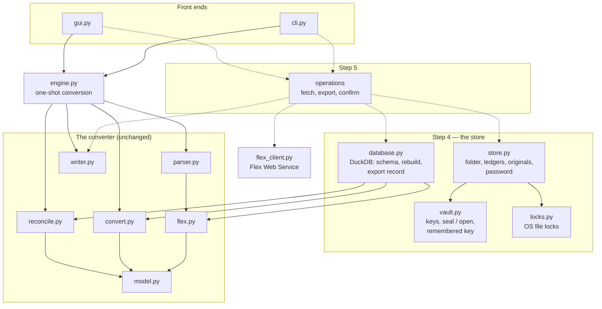

# The store's modules — plan

*Layout agreed with Sergei 2026-11-14. Step 4 of the build order in
[2026-11-11-flex-store-plan.md](2026-11-11-flex-store-plan.md), whose decisions (D6–D22) this
implements; nothing here changes them. Names of functions are working names and may change in
the code. As each module is built, its place in the diagram, its arrows and its interfaces
become items of [ARCHITECTURE.md](../ARCHITECTURE.md), which then holds the current design;
this plan stays the record of what was agreed.*

## The layers

Four new modules under `ibkr_to_xero/`, each depending only on those below it. Only
`database.py` knows DuckDB, so a change of engine touches one file; only `store.py` knows the
folder; the converter modules do not change.

Dashed: step 5, not built here. Third-party dependencies: `vault.py` — `cryptography`,
`keyring`; `database.py` — `duckdb` (our build, D22); the rest — the standard library.

## The modules

| Module | Its job (decisions) | Knows nothing of |
|---|---|---|
| `vault.py` | A random store key; a key from the password with `scrypt`; the store key locked and unlocked with it, as the contents of `store.key`; bytes sealed and opened — `zlib`, then AES-GCM; the key remembered in, read from and forgotten by the OS credential store (D8, D9) | Folders, DuckDB |
| `locks.py` | An exclusive lock on a file — `msvcrt` on Windows, `fcntl` on macOS — released when its process dies; a busy lock is refused at once, never waited on (D21) | Everything else |
| `store.py` | The folder (D7, D14): a store created, or opened with the remembered key or else the password; the password changed (only `store.key` rewritten); starting over, which renames the old folder aside and never deletes it (D9); the ledger index; each ledger's settings — Flex token and query ID, IB accounts, currencies and their dates, GST rate (D12, D20, D57); originals added and read, named by a hash of their content (D6); the store and ledger locks (D21) | DuckDB |
| `database.py` | DuckDB only (D22): `data.db` and `exports.db` opened, encrypted with the store key handed to it (D8); the schema, amounts `DECIMAL(38,11)` (D18); `data.db` rebuilt from the originals when the parser version it records is not the current one (D6) — each Flex report parsed to the model, `convert` and `reconcile` run per period and IB account, its rows and lines written; the export record (D10) | Folders, passwords |

**One direction only.** The model is written into tables and never read back into a
`Statement`: exports read the finished `line` rows, reports query the tables. No reverse
mapping, no tests for one.

**GST gets a home of its own.** Reconciliation takes the ledger's GST rate as a parameter
(D57), and with that change `fee_gst` moves out of `convert.py` into a module both
`convert.py` and `reconcile.py` use, so reconciliation no longer depends on conversion
(ARCHITECTURE AD-011, agreed 2026-11-14).

**The parser version** is a constant beside the Flex mapping, raised whenever what a report
maps to changes; `data.db` records the one it was built with, and a mismatch rebuilds it.

## Interfaces, in outline

- `vault`: `new_key()`; `lock_key(key, password, cost)` → the contents of `store.key`;
  `unlock_key(contents, password)` → the key, or `WrongPassword`; `seal(key, data, purpose)` /
  `unseal(key, sealed, purpose)` — `purpose` names the file (`index`, `ledger:<id>`,
  `original:<hash>`) and is authenticated with it, so one sealed file cannot stand in for
  another; `remember(store_id, key)`, `remembered(store_id)`, `forget(store_id)`.
- `locks`: `with locked(path, what):` — `Busy(what)` when someone else holds it, naming what
  is running there.
- `store`: `Store.create(folder, password, remember)`; `Store.open(folder, password=None)` —
  the remembered key first, then the password: `PasswordNeeded`, `WrongPassword`,
  `StoreUnreadable`; `change_password`; `start_over`; `ledgers()`, `add_ledger`,
  `rename_ledger`, `remove_ledger`; per ledger: `settings` read and saved, `add_original(data)`,
  `originals()`, `read_original(name)`, the paths of its two databases; `with store.locked():`
  and `with ledger.locked():`.
- `database`: `open_data(path, key)`, `open_exports(path, key)`; `ensure_current(con,
  originals)` — a rebuild only if the parser version moved; the export record —
  `unexported_lines(to_date)`, `record_export(...)`, `confirm(file)`.

## Tests

One file per module, in temporary folders. An in-memory `keyring` backend stands in for the
OS store. The `scrypt` cost is part of `store.key`, so tests lock keys with a cheap one rather
than paying half a second per unlock. `database.py`'s tests rebuild from synthetic Flex reports,
built as `tests/test_flex.py` builds them, and from the real ones in `examples/flex/` when
present (skipped otherwise), checking the lines against the converter's own output for them.

## Not in step 4

The operations — catching up from the end of the stored data, the cash continuity check at
each join, choosing what to export, a manual re-fetch (D1, D5, D10, D12, D13) — are step 5: a
library module both front ends drive, so `cli.py` and `gui.py` stay thin.

## Order of work

**The DuckDB wheel workflow comes first** (Sergei, 2026-11-14): `database.py` needs our build
to write encrypted files, and developing on the published wheel means the tests run on the
DuckDB that ships, on Windows and the Mac alike. Then the modules, bottom up: `vault.py`,
`locks.py`, `store.py`, `database.py`.
