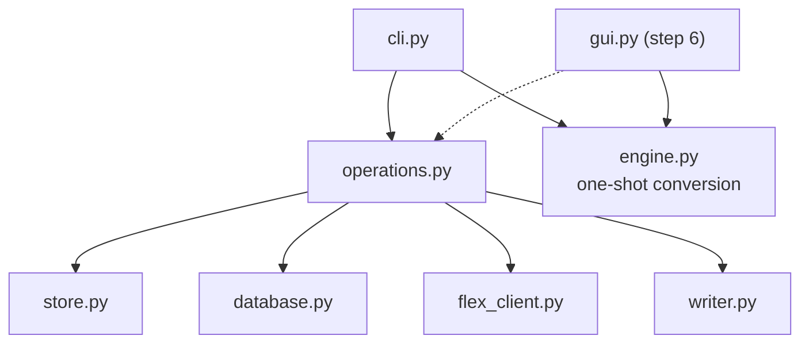

# The CLI over the store — plan

*Drafted 2026-11-21, its four open questions decided the same day (D66–D69). Step 5 of the
build order in [2026-11-11-flex-store-plan.md](2026-11-11-flex-store-plan.md): the operations
both front ends drive, and the CLI's commands over them. It carries out D1, D2, D5, D10, D12,
D13, D15, D20 and D21 on the store built in step 4
([2026-11-14-store-modules-plan.md](2026-11-14-store-modules-plan.md)); what it adds to them is
under [Decided](#decided). As each part is built its items join
[ARCHITECTURE.md](../ARCHITECTURE.md), from AD-120.*

## I3 — What Flex returns near today (established 2026-11-21)

Probed live with Sergei's query, ten requests, on a Saturday at 13:19 in Adelaide — 21:49
on the Friday in New York:

- **A range reaching a day IBKR has not closed is refused whole,** never shortened: error
  1003, "Statement is not available". Every range ending on that Friday or later was refused;
  one ending on the Thursday came back as asked.
- **A range holding no business day is refused the same way** — a Saturday and Sunday alone.
  A range that starts or ends on a weekend day but holds a business day comes back with
  exactly the dates asked.
- `whenGenerated` is Sydney time, as seen before.
- *Not known:* what a range starting before the account was funded returns. IBKR says no
  statement exists before then; if it is a 1003, a first run on an account under a year old
  needs a later start date (below).

## The layers

One new module, `operations.py`, between the front ends and the store. It is the only one
that knows the whole sequence — fetch, check, keep, build, export — so `cli.py` and later
`gui.py` stay thin.



**Operations never ask.** Every answer is a parameter and every question a typed result or
error, so the CLI asks on the terminal and the GUI in a dialog, over the same calls. Each
operation takes its ledger's lock for its whole run (D21) — a first fetch can hold it for
twenty minutes while IBKR generates a year — opens the databases and closes them before it
returns.

## The operations

- **`fetch(ledger)` — catching up** (D1, D2). From the day after the stored data ends to the
  last day IBKR has closed. That day is found by asking (I3): the first request ends on
  yesterday in New York — taken as UTC less five hours, which is never more than an hour out
  and needs no time-zone database — and each 1003 steps the end back a day, for at most a
  week. Still refused, with the range starting inside that week: up to date, nothing fetched.
  Otherwise the error stands. More than 365 days to catch up: 365-day requests, oldest first.
  **Every report is checked before it is kept** (D16), and one that fails keeps nothing:
  - read, converted and reconciled at the ledger's GST rate (`database.read_report`);
  - its IB account the ledger's — the first fetch records it, and its base currency (D20);
  - **it joins the stored data** ([D69](#d69)): by date, the day after the stored end; by
    cash (D5), per currency, its Starting Cash equals the stored Ending Cash
    before it, to a millionth (the reconciliation's tolerance; Flex writes a currency holding
    nothing as ±0.000000002), a currency missing from either side counting as zero. A
    mismatch names the currency, both amounts and the boundary date, and points at `refetch`.

  Then `add_original` and `ensure_current`. It returns the periods added and the currencies
  that still have no Xero date.
- **The first run** (D12, D13). With nothing stored, `fetch` asks IBKR for the last 365 days in
  one request. The caller then asks, per currency of its Cash Report, the last date already in
  Xero — or "nothing in Xero yet" with a start date, which counts everything before it as
  imported — and saves the answers with `set_xero_dates`. `fetch_back(ledger)` then fetches
  backwards in 365-day chunks to the day after the earliest date, each chunk's Ending Cash
  checked against the Starting Cash of the one after it; a currency first seen there is
  returned to be asked about. If the first request is refused because the account is younger
  than a year (I3), the caller is told to give a start date, and the first request starts there.
- **`export(ledger, to=None, folder=None, skip_zero=False)`** (D10). Refused while a currency
  has no Xero date, or while a file of an earlier export awaits an answer ([D67](#d67)). Up to
  `to`, by default the end of the stored data, it takes `unexported_lines`, writes a CSV per
  currency and a report into a new folder ([D68](#d68)), and records the export with its files pending.
  Nothing unexported: no folder, nothing recorded. The first export after the Xero dates were
  set also lists, for the user to check against Xero, the lines whose own date and report date
  fall either side of their currency's date — the gap D7 names.
- **`resolve(ledger, answers)`** — per pending file, imported into Xero (confirmed) or not
  (discarded: its lines become exportable again, and it can no longer be confirmed).
- **`reexport(ledger, start, end, folder)`** — D10's re-export regardless of the record: every
  line dated in the range, written, not recorded.
- **`refetch(ledger, start, end)` → a preview; `keep(preview)`** — D5's manual re-fetch
  ([D66](#d66)). The preview lists, per period, the lines added, removed and changed and any
  change to the Cash Report; changed or removed lines already confirmed as imported are
  marked, for the user to correct in Xero by hand. Nothing is stored unless kept.
- **`status(ledger)`** — the stored range, when it was last fetched, the currencies and their
  Xero dates, the pending files.

Two small changes below the operations:

- `flex_client`: error 1003 raises `FlexNotAvailable`, a `FlexError`, so `fetch` can tell it
  from the rest.
- `data.db` keeps the reconciliation's notes per period and currency — GST verified or
  attributed, a rounding line — in a `note` table (schema 2, a rebuild), so an export's report
  carries the notes of the periods it draws on, as the one-shot report does.

## The commands

```
ibkr2xero FILE [-o DIR] [-f] [-s] [-r NAME] ...    convert one statement, as today
ibkr2xero fetch    [-a ACCOUNT]                    catch up from IBKR
ibkr2xero export   [-a ACCOUNT] [--to DATE] [-o DIR] [-s]
ibkr2xero export   [-a ACCOUNT] --again --from DATE --to DATE [-o DIR] [-s]
ibkr2xero confirm  [-a ACCOUNT]                    answer for pending files
ibkr2xero refetch  [-a ACCOUNT] --from DATE --to DATE
ibkr2xero status   [-a ACCOUNT]
ibkr2xero account  add NAME | list | rename NAME NEW | remove NAME
ibkr2xero account  token NAME | query NAME ID      replace the Flex token or query ID
ibkr2xero password [--remember | --forget]         change it, or what this computer keeps
ibkr2xero start-over                               a new store; the old one set aside (D62)
```

- **Today's usage is unchanged.** A first word naming a command selects it; anything else is a
  statement file, converted as now. A statement file called `fetch` is given as `./fetch`.
- **`-a` names the account** — D20's word on screen for a ledger. With one account in the
  store it may be left out.
- **The store is created by the first `account add`**: a new password, typed twice, then
  whether to remember it on this computer, with D9's warning beside it. Then the query ID, then
  the token. `--store DIR`, on every command, works on another folder — for tests, and for a
  store set aside by `start-over`.
- **Questions are asked on the terminal.** The password and the Flex token without echo
  (`getpass`); the token never as an argument, where shell history and process lists would
  keep it. The Xero date per currency, with one answer for all. Per pending file, "imported
  into Xero? [y/n]". Whether to keep a re-fetch. `account remove` asks for the account's name
  to be typed again (D61). With no terminal to ask on, a needed question is an error naming
  the command that answers it.
- **Output** as the one-shot CLI's: full paths on the console, bare names in the saved report
  (AD-056); IBKR's progress lines on standard error while a report is generated. Exit 0 when
  done or nothing was needed, 2 when refused or rejected — "nothing was kept" or "no output
  files were written", as the case is.

## Tests

- `tests/test_operations.py`: a fake client serving synthetic reports, built as
  `tests/test_flex.py` builds them, per range, with 1003 past a chosen last closed day.
  Catching up, stepping back, chunks, the continuity check, a report of another account, the
  first run and `fetch_back`, export, confirm and discard, re-export, re-fetch's preview and
  keep. On Linux, where PyPI's DuckDB cannot write encrypted files, they skip as the database's
  do (D65).
- `tests/test_cli_store.py`: the commands end to end on a temporary `--store`, the terminal's
  answers scripted.
- With `examples/flex/` present: catching up across the real reports, which must give the
  lines the converter gives for them.
- Once built, a live run by hand on Sergei's query: a first run, then a catch-up.

## Decided

- <a id="d66"></a>**D66 — A re-fetch repeats stored periods exactly** *(Sergei, 2026-11-21)*.
  Each stored period the range touches is fetched again with that period's own dates, one
  request each; a range ending inside a period takes the whole period, since a period's Cash
  Report cannot be split. Period boundaries never move, so a kept re-fetch is the case
  `database.py` already settles — the later report of one period wins (AD-115) — and every
  line keeps its key, synthetic rows included: a changed MTM line shows as changed, not as one
  removed and another added. A range reaching outside the stored data is refused, naming the
  stored range: later days are `fetch`'s, earlier ones the first run's `fetch_back`. *Cost:* a
  fortnight of daily periods is about ten requests, a minute or two at IBKR's ten a minute; a
  fortnight inside the first run's 365-day period is that whole year again, one request of
  8–20 minutes. *Declined:* one request for the whole range — fast, but it would replace the
  periods it spans with one, re-keying their synthetic rows, so the lines already in Xero
  would all come back as removed with one new line in their place.
- <a id="d67"></a>**D67 — An export waits for an answer on every pending file** *(Sergei,
  2026-11-21; refines D10)*. Before writing anything, an export asks of each file still
  pending whether it was imported into Xero. *Yes* confirms it, and its lines are never
  exported again; *no* discards it — its lines go into the new export, and the old file can
  never be confirmed afterwards. Until every pending file has an answer the export does not
  run; with no terminal to ask on, it stops and names `ibkr2xero confirm`. `export_file`
  gains the status `discarded`. *Declined:* leaving unanswered files pending while their lines
  are exported again — no question asked, but the same lines would then sit in two pending
  files, and importing and confirming both would put them into Xero twice, unnoticed.
- <a id="d68"></a>**D68 — An export's folder and files are named for the account** *(Sergei,
  2026-11-21; names what D14 left open)*. A folder per account under the user's Documents
  (Windows: the Documents known folder, wherever it has been moved), a subfolder per export,
  named by date so they sort, and the account in each file name:

  ```
  Documents\IBKR to Xero\My IBKR\
    2026-11-21 up to 2026-11-20\              export on the 21st of everything to the 20th
      My IBKR AUD.csv
      My IBKR USD.csv
      ibkr2xero_report.txt
    2026-11-21 up to 2026-11-20 2\            a second export the same day
    2026-11-21 re-export 2026-11-01 to 2026-11-14\
  ```

  A character a file name cannot hold, in the account's name, becomes `-`. `-o DIR` puts the
  export's files in DIR instead. *Why the account in the file name:* with two accounts each
  holding USD, files picked from a list in Xero's import dialog say which is which. The one-shot
  conversion keeps its plain `{CCY}.csv`. *Declined:* plain `{CCY}.csv` in the per-account
  folders, and one flat folder of exports named `<date> <account>`.
- <a id="d69"></a>**D69 — The store always joins up** *(Sergei, 2026-11-21; widens D5's
  check)*. Per IB account, the stored periods cover every day from the first to the last with
  no gap or overlap — a catch-up starts the day after the stored end, a fetch back ends the day
  before the stored start, a weekend joins the period after it — and each period's Starting
  Cash equals the Ending Cash before it. Every addition is checked for both: a catch-up, a chunk
  going back, a re-fetch kept. A re-fetch that would leave a cash break with its neighbours is
  refused, naming the boundary and how far to widen it. The database build refuses a gap as it
  already refuses an overlap. *Why:* checked at a fresh fetch only, as D5 has it, a re-fetch
  could be kept with a break left inside the store that nothing reports again, and Xero would
  sit that far from IBKR with no line to explain it. *Declined:* the check at a fresh fetch
  only.
